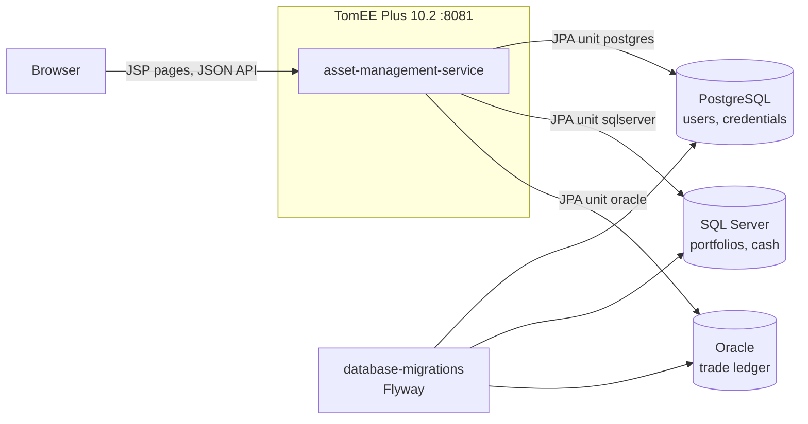

# Stock market project

A stock-trading web application built with Jakarta Servlets, EJB, JPA, and JSP on Apache TomEE Plus.
Its data is split across three databases: users in PostgreSQL, portfolios and cash in SQL Server, and the
trade ledger in Oracle.



| Module | Responsibility |
| --- | --- |
| `asset-management-service` | TomEE Plus WAR. Users, portfolios, trading, the UI, and the JSON API. |
| `database-migrations` | Flyway migrations for the three databases; provisions the SQL Server application login. |

The asset-management service follows Boundary–Control–Entity, with the beans managed by the TomEE EJB container:

- `application` – session hardening listener and environment configuration (`AppConfig`).
- `boundary` – one package per channel: `http` (security filter and shared HTTP helpers), `page` (HTML pages),
  and `api` (JSON endpoints, beans injected with `@EJB`).
- `control` – business rules as `@Stateless` beans; `TradingControl` is a `@Singleton` because it shares
  per-portfolio locks, and `MarketControl` is a `@Singleton` holding the tradable stocks and their fixed prices.
- `control.repository` – `@Local` repository interfaces and their `@Stateless` JPA implementations
  (`JpaUserRepository`, `JpaUserCredentialRepository`, `JpaPortfolioRepository`, `JpaTradeRepository`), each
  using the `EntityManager` of one persistence unit; `Database` runs the health checks.
- `entity` – JPA entities (`UserEntity`, `CredentialEntity`, `PortfolioEntity`, `TradeEntity`) and the
  immutable records the controls and the API work with.

## Persistence (JPA)

TomEE Plus provides the JPA implementation (Apache OpenJPA) and the JTA transaction manager.
`asset-management-service/src/main/resources/META-INF/persistence.xml` declares one persistence unit per
database, and `asset-management-service/src/main/webapp/WEB-INF/resources.xml` declares their data sources
from the environment variables below.

| Persistence unit | Data source | Database | Entities → tables |
| --- | --- | --- | --- |
| `postgres` | `PostgresDataSource` | PostgreSQL | `UserEntity` → `users`, `CredentialEntity` → `user_credentials` |
| `sqlserver` | `SqlServerDataSource` | SQL Server | `PortfolioEntity` → `dbo.portfolios` |
| `oracle` | `OracleDataSource` | Oracle | `TradeEntity` → `trades` |

Each repository method runs in its own container-managed transaction on a single database, so a
transaction never spans two engines; `TradingControl` coordinates SQL Server and Oracle with a compensating
action (see below). Flyway owns the schemas, so JPA maps the existing tables and never changes them.

## Run locally

Requirements: JDK 21, Maven, Docker, and Homebrew `tomee-plus`.

```bash
./run.sh
```

`run.sh`:

1. creates `.env` from `.env.example` on the first run (development values; `.env` is git-ignored);
2. starts PostgreSQL, SQL Server, and Oracle, and waits until they are healthy;
3. applies the Flyway migrations;
4. builds the WAR, deploys it as `ROOT.war`, and starts TomEE Plus;
5. waits for `/health` and prints the URLs.

The TomEE Plus base directory defaults to `<repository>/servere/tomee-base` and is created if missing.
Set `SERVERS_DIR` (in `.env` or the shell) to use another location. Press `Ctrl+C` to stop everything, or
run `./stop.sh` from another terminal.

| Page | URL |
| --- | --- |
| Overview (net worth, portfolios, stocks) | <http://localhost:8081/> |
| Market (stocks, prices, buy/sell) | <http://localhost:8081/market> |
| Assets (holdings, allocation, P/L, trade ledger) | <http://localhost:8081/assets> |
| Portfolios and account (create/rename/delete, profile) | <http://localhost:8081/portfolios> |
| Log in / create account | <http://localhost:8081/auth.html> |

New accounts start with a "Main portfolio" holding $1,000.00. Accounts created before this version
have no portfolio yet; create one on the Portfolios page.

## Trading model

- Each portfolio has its own cash balance in SQL Server; every execution is a row in the Oracle
  `trades` ledger with its execution price. Holdings and cost basis are derived from the ledger
  (moving-average cost).
- Five stocks (AAPL, AMZN, MSFT, NVDA, TSLA) are traded at fixed prices defined in `MarketControl`;
  orders always use the server's price, never a client-supplied one. The amount is rounded to cents and
  must be at least $0.01; quantities allow six decimals.
- Cash moves first: the portfolio row is read with a row lock (`WITH (UPDLOCK)`) and updated only if the
  balance stays non-negative, so it can never go negative. The trade is then recorded in Oracle. If that
  fails, the cash movement is reversed (a compensating action); if the reversal also fails, the log contains
  `MANUAL RECONCILIATION REQUIRED`.
- Orders for the same portfolio are serialized inside the service, so two sales cannot both pass
  the holdings check. This assumes a single asset-management instance.
- A recorded trade can be corrected (quantity) or voided. The cash difference is settled at the
  original price, and a change that would leave a later sale without enough shares is refused.

## HTTP API

All `/api` routes require a session and return JSON (`{"error": "…"}` on failure). Requests that
change data must send `X-Requested-With: XMLHttpRequest`; the browser client does this.

| Method | Route | Description |
| --- | --- | --- |
| POST | `/auth/register` | `{username, email, password}`; creates the user and a funded portfolio, signs in |
| POST | `/auth/login` | `{username, password}` |
| POST | `/auth/logout` | Ends the session |
| GET | `/api/session` | The signed-in user |
| GET, PUT, DELETE | `/api/users/{id}` | Own profile; `DELETE` also removes all portfolios and trades |
| GET, POST | `/api/portfolios` | List or create `{portfolioName}` |
| GET, PUT, DELETE | `/api/portfolios/{id}` | Read, rename `{portfolioName}`, delete with its trades |
| GET | `/api/portfolios/{id}/account` | Cash, holdings, valuation, unrealized P/L |
| GET, POST | `/api/portfolios/{id}/trades` | Ledger, or a market order `{symbol, side, quantity}` |
| GET, PUT, DELETE | `/api/trades/{id}` | Read, correct `{quantity}`, or void a trade |
| GET | `/api/market`, `/api/market/{symbol}` | Stocks and their prices |
| GET | `/dashboard` | User, portfolios, and trades joined across the three databases |
| GET | `/health` | Database status (public; 503 when a database is unreachable) |

```bash
curl -c jar -H 'Content-Type: application/json' -H 'X-Requested-With: XMLHttpRequest' \
  -d '{"username":"alice","email":"alice@example.com","password":"a-long-password"}' \
  http://localhost:8081/auth/register
curl -b jar http://localhost:8081/api/portfolios
# Use the portfolioId returned above.
curl -b jar -H 'Content-Type: application/json' -H 'X-Requested-With: XMLHttpRequest' \
  -d '{"symbol":"AAPL","side":"BUY","quantity":"0.5"}' \
  http://localhost:8081/api/portfolios/<portfolioId>/trades
```

## Security

- Passwords: PBKDF2-HMAC-SHA256 with 210,000 iterations and a random salt. Five failed attempts
  lock the account for 15 minutes; unknown usernames take as long to reject as wrong passwords.
- Sessions: a new session on login and registration, cookie-only tracking, `HttpOnly` and
  `SameSite=Strict`, 30-minute timeout.
- CSRF: state-changing requests need the `X-Requested-With` header and, when present, a matching
  `Origin`.
- Authorization: the user always comes from the session. Portfolios and trades of other users
  answer 404, so their IDs cannot be probed.
- Headers: a strict Content-Security-Policy (no inline scripts or styles), `nosniff`,
  `X-Frame-Options: DENY`, `Referrer-Policy: same-origin`.
- Secrets come only from the environment. The application connects to SQL Server with the
  `stock_app` login (read/write on `stock_market` only), not `sa`.

## Configuration

| Variable | Default | Used by |
| --- | --- | --- |
| `POSTGRES_URL`, `POSTGRES_USER` | `jdbc:postgresql://localhost:5432/stock_market`, `stock_app` | asset service |
| `POSTGRES_PASSWORD` | required | asset service, Postgres container |
| `SQLSERVER_URL`, `SQLSERVER_USER` | `jdbc:sqlserver://localhost:1433;databaseName=stock_market;encrypt=false`, `stock_app` | asset service, migrations |
| `SQLSERVER_PASSWORD` | required | asset service, migrations (creates the login) |
| `MSSQL_SA_PASSWORD` | in `.env` | SQL Server container, migrations |
| `ORACLE_URL`, `ORACLE_APP_USER` | `jdbc:oracle:thin:@localhost:1521/FREEPDB1`, `stock_app` | asset service |
| `ORACLE_APP_PASSWORD` | required | asset service, Oracle container |
| `SERVERS_DIR` | `<repository>/servere` | scripts |

The database variables are read by the TomEE data sources in `WEB-INF/resources.xml`
(`${NAME:-default}` placeholders). The asset service refuses to start if a password is missing and names it
in the TomEE log.

## Tests

```bash
mvn verify
```

Unit tests cover trading and compensation, holdings math, the stock catalogue, authentication,
portfolio ownership, configuration, CSRF checks, and database error mapping. The deploy script skips tests
to keep `run.sh` fast, so run `mvn verify` before committing.

## Database layout and reset

- PostgreSQL: `users`, `user_credentials`.
- SQL Server: `portfolios` with `cash_balance`; `user_id` refers to PostgreSQL.
- Oracle: `trades` with `price`; `portfolio_id` refers to SQL Server.

Foreign keys cannot span database engines, so the controls validate ownership before writing and
clean up in dependency order. To reset all data:

```bash
docker compose down -v
docker compose up -d --wait postgres sqlserver oracle
docker compose run --rm --build database-migrations
```
