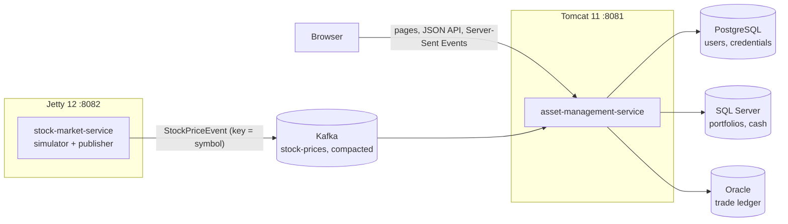

# Stock market project

A distributed stock-trading application built with plain Jakarta Servlets: a price simulator on
Jetty, a portfolio service on Tomcat, Kafka between them, and data split across PostgreSQL,
SQL Server, and Oracle.



| Module | Responsibility |
| --- | --- |
| `stock-market-contracts` | The Kafka message `StockPriceEvent` and its Jackson codec, shared by both services. |
| `stock-market-service` | Jetty WAR. Simulates five stocks and publishes every price change. `GET /health`. |
| `asset-management-service` | Tomcat WAR. Consumes prices, runs portfolios and trading, serves the UI and API. |
| `database-migrations` | Flyway migrations for the three databases; provisions the SQL Server application login. |

The asset-management service follows Boundary–Control–Entity:

- `application` – composition root (`ApplicationContext`) and environment configuration (`AppConfig`).
- `boundary` – servlets, the security filter, the Kafka consumer, and the Server-Sent Events hub.
- `control` – business rules: authentication, portfolios, trading, market state, health.
- `entity` – records and JDBC repositories, one HikariCP pool per database.

## Run locally

Requirements: JDK 21, Maven, Docker, and Homebrew `tomcat` and `jetty`.

```bash
./run.sh
```

`run.sh`:

1. creates `.env` from `.env.example` on the first run (development values; `.env` is git-ignored);
2. starts Kafka, PostgreSQL, SQL Server, and Oracle, and waits until they are healthy;
3. applies the Flyway migrations and creates the compacted `stock-prices` topic;
4. builds both WARs once, deploys them as `ROOT.war`, and starts Tomcat and Jetty;
5. waits for both `/health` endpoints and prints the URLs.

The Tomcat and Jetty base directories default to `<repository>/servere/tomcat-base` and
`<repository>/servere/jetty-base` and are created if missing. Set `SERVERS_DIR` (in `.env` or the
shell) to use another location. Press `Ctrl+C` to stop everything, or run `./stop.sh` from another
terminal.

| Page | URL |
| --- | --- |
| Overview (net worth, portfolios, market) | <http://localhost:8081/> |
| Live market (quotes, sparklines, buy/sell) | <http://localhost:8081/live-market> |
| Assets (holdings, allocation, P/L, trade ledger) | <http://localhost:8081/assets> |
| Portfolios and account (create/rename/delete, profile) | <http://localhost:8081/portfolios> |
| Log in / create account | <http://localhost:8081/auth.html> |

New accounts start with a "Main portfolio" holding $1,000.00. Accounts created before this version
have no portfolio yet; create one on the Portfolios page.

## Trading model

- Each portfolio has its own cash balance in SQL Server; every execution is a row in the Oracle
  `trades` ledger with its execution price. Holdings and cost basis are derived from the ledger
  (moving-average cost).
- Orders execute at the latest price the server received from Kafka, never a client-supplied price.
  The amount is rounded to cents and must be at least $0.01; quantities allow six decimals.
- Cash moves first with a conditional `UPDATE … WHERE cash_balance + ? >= 0`, so the balance can
  never go negative. The trade is then recorded in Oracle. If that fails, the cash movement is
  reversed (a compensating action); if the reversal also fails, the log contains
  `MANUAL RECONCILIATION REQUIRED`.
- Orders for the same portfolio are serialized inside the service, so two sales cannot both pass
  the holdings check. This assumes a single asset-management instance.
- A recorded trade can be corrected (quantity) or voided. The cash difference is settled at the
  original price, and a change that would leave a later sale without enough shares is refused.

## HTTP API

All `/api` routes require a session and return JSON (`{"error": "…"}` on failure). Requests that
change data must send `X-Requested-With: XMLHttpRequest`; the browser client does this.

| Method | Route | Description |
| --- | --- | --- |
| POST | `/auth/register` | `{username, email, password}`; creates the user and a funded portfolio, signs in |
| POST | `/auth/login` | `{username, password}` |
| POST | `/auth/logout` | Ends the session |
| GET | `/api/session` | The signed-in user |
| GET, PUT, DELETE | `/api/users/{id}` | Own profile; `DELETE` also removes all portfolios and trades |
| GET, POST | `/api/portfolios` | List or create `{portfolioName}` |
| GET, PUT, DELETE | `/api/portfolios/{id}` | Read, rename `{portfolioName}`, delete with its trades |
| GET | `/api/portfolios/{id}/account` | Cash, holdings, valuation, unrealized P/L |
| GET, POST | `/api/portfolios/{id}/trades` | Ledger, or a market order `{symbol, side, quantity}` |
| GET, PUT, DELETE | `/api/trades/{id}` | Read, correct `{quantity}`, or void a trade |
| GET | `/api/market`, `/api/market/{symbol}` | Latest quotes with previous price and short history |
| GET | `/api/market/stream` | Server-Sent Events: one `snapshot`, then a `quote` per update |
| GET | `/dashboard` | User, portfolios, and trades joined across the three databases |
| GET | `/health` | Database and market-feed status (public; 503 when degraded) |

```bash
curl -c jar -H 'Content-Type: application/json' -H 'X-Requested-With: XMLHttpRequest' \
  -d '{"username":"alice","email":"alice@example.com","password":"a-long-password"}' \
  http://localhost:8081/auth/register
curl -b jar http://localhost:8081/api/portfolios
curl -b jar -H 'Content-Type: application/json' -H 'X-Requested-With: XMLHttpRequest' \
  -d '{"symbol":"AAPL","side":"BUY","quantity":"0.5"}' \
  http://localhost:8081/api/portfolios/1/trades
```

## Security

- Passwords: PBKDF2-HMAC-SHA256 with 210,000 iterations and a random salt. Five failed attempts
  lock the account for 15 minutes; unknown usernames take as long to reject as wrong passwords.
- Sessions: a new session on login and registration, cookie-only tracking, `HttpOnly` and
  `SameSite=Strict`, 30-minute timeout.
- CSRF: state-changing requests need the `X-Requested-With` header and, when present, a matching
  `Origin`.
- Authorization: the user always comes from the session. Portfolios and trades of other users
  answer 404, so their IDs cannot be probed.
- Headers: a strict Content-Security-Policy (no inline scripts or styles), `nosniff`,
  `X-Frame-Options: DENY`, `Referrer-Policy: same-origin`.
- Secrets come only from the environment. The application connects to SQL Server with the
  `stock_app` login (read/write on `stock_market` only), not `sa`.

## Configuration

| Variable | Default | Used by |
| --- | --- | --- |
| `POSTGRES_URL`, `POSTGRES_USER` | `jdbc:postgresql://localhost:5432/stock_market`, `stock_app` | asset service |
| `POSTGRES_PASSWORD` | required | asset service, Postgres container |
| `SQLSERVER_URL`, `SQLSERVER_USER` | `jdbc:sqlserver://localhost:1433;databaseName=stock_market;encrypt=false`, `stock_app` | asset service, migrations |
| `SQLSERVER_PASSWORD` | required | asset service, migrations (creates the login) |
| `MSSQL_SA_PASSWORD` | in `.env` | SQL Server container, migrations |
| `ORACLE_URL`, `ORACLE_APP_USER` | `jdbc:oracle:thin:@localhost:1521/FREEPDB1`, `stock_app` | asset service |
| `ORACLE_APP_PASSWORD` | required | asset service, Oracle container |
| `KAFKA_BOOTSTRAP_SERVERS`, `KAFKA_TOPIC` | `localhost:9092`, `stock-prices` | both services |
| `SERVERS_DIR` | `<repository>/servere` | scripts |

The asset service refuses to start if a required variable is missing and names it in the Tomcat log.

## Kafka contract

```json
{"symbol":"AAPL","name":"Apple Inc.","price":190.25,"quantity":12,"timestamp":"2026-10-25T12:00:00Z"}
```

Messages are keyed by symbol on a compacted topic, so the latest price per symbol is always kept.
The asset service replays the topic from the beginning on every start (unique consumer group, no
committed offsets), so the market is complete immediately after a restart. Malformed messages are
logged and skipped. Price updates reach browsers through one bounded queue per connection, so a
slow browser cannot delay the others or the Kafka consumer.

## Tests

```bash
mvn verify
```

Unit tests cover trading and compensation, holdings math, market state, authentication,
portfolio ownership, configuration, CSRF checks, and the Kafka codec. The deploy scripts skip
tests to keep `run.sh` fast, so run `mvn verify` before committing.

## Database layout and reset

- PostgreSQL: `users`, `user_credentials`.
- SQL Server: `portfolios` with `cash_balance`; `user_id` refers to PostgreSQL.
- Oracle: `trades` with `price`; `portfolio_id` refers to SQL Server.

Foreign keys cannot span database engines, so the controls validate ownership before writing and
clean up in dependency order. To reset all data:

```bash
docker compose down -v
docker compose up -d --wait kafka postgres sqlserver oracle
docker compose run --rm --build database-migrations
```
